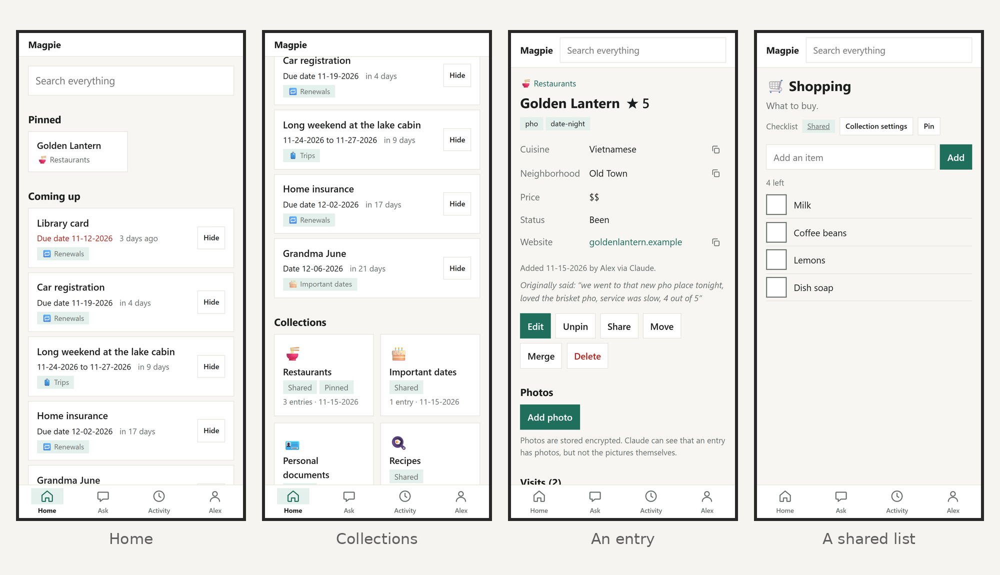

# Magpie (the Tell Me Anything Tracker)

A shared household memory you talk to through Claude. Tell Claude "we went to that new pho place tonight, loved the brisket pho, service was slow, 4 out of 5" and it files it; later ask "what Thai places have we liked?" or "what did I say about that taco place last month?" and it finds it. Like its namesake, it collects whatever you bring it.

<p></p>

More screens: [an entry's visits and history](docs/screens/visits.png), [a recipe](docs/screens/recipe.png), [search](docs/screens/search.png), [Activity with Undo](docs/screens/activity.png). All of it is made-up data.

It is a small app you run yourself, one copy per household, for about $4 a month. Claude does the filing
through a connector, on the Claude plan you already have (the Free plan allows one custom connector). There
is no company in the middle and no account to create with anyone but your host.

## Is it safe to put my information in?

Short version: your copy is yours, the sensitive parts are encrypted, and this page says plainly what is not.

- **Who runs it.** You do. Your entries live in one database file on your own server. Nothing is sent anywhere
  except to Anthropic when Claude or the Ask box reads or saves something for you, and to your own backup
  bucket if you switch backups on. There is no tracking and no analytics.
- **What is encrypted.** Photos and PDFs always. For a collection you mark **sensitive** (IDs, insurance,
  documents): its details, notes, visits and history, in the database and in every backup of it. So is
  everything typed into the Ask box.
- **What is not.** Titles, tags, ratings and dates, and anything in an ordinary collection. Keep numbers out
  of titles.
- **Who could still read it.** Anyone who controls your hosting account, so give that a strong password and
  two-factor sign-in. And Anthropic sees what Claude reads to you, like the rest of your chats.
- **What not to store.** Passwords, card numbers, bank logins. Use a password manager for those.
- **Getting out.** Settings > Download everything gives you the database and every photo. Deleting the app
  on your host deletes the rest.
- **The one thing to keep.** Setup makes a key and saves it to `magpie-photo-key.txt`. Put it in a password
  manager. Without it, photos and sensitive entries cannot be recovered, by anyone.

The code has had two independent security reviews and has about 250 tests, including ones that read the
database file's own bytes to prove sensitive text is not in it. `SECURITY.md` has how to report a problem
and the known limits; "Photos and personal documents" below has the full account.

## Set it up: one command

Magpie runs in your own Fly.io account. Fly.io needs a card on file, and this costs about $4 a month. Get a copy of this folder first (`git clone`, or download it), then take one of three routes:

1. **With Claude Code.** Open Claude Code in this folder and say "Set up my own Magpie". It asks for your email, first name and time zone (and a second person's, if there is one), runs the setup for you, and tells you how to connect. It never sees your passwords: they go to a file that you open. (It follows `docs/setup-with-claude.md`.)
2. **Windows.** Double-click `setup.cmd`, or run `.\setup.cmd` in a terminal in this folder.
3. **macOS or Linux.** Run `./setup.sh` in a terminal in this folder.

About five minutes, most of it waiting. The setup:

1. installs the Fly.io tool if you don't have it (it asks first),
2. opens your browser to log in to Fly.io,
3. asks for your email and, if you like, a second person's, and for your time zone,
4. creates the app, its disk and its settings, deploys it and checks it,
5. prints the address to paste into Claude and a sign-in password for each person. The passwords are also saved to `magpie-login.txt`, before the deploy, so they are not lost if it stops.

You don't need Node, Docker, Google or Cloudflare for this. If it stops partway (no card on file yet, say), run it again and it continues where it stopped.

Two files appear in the folder. Put both in your password manager, then delete them:

- `magpie-login.txt`: the sign-in passwords.
- `magpie-photo-key.txt`: the key that encrypts photos and sensitive entries. **They cannot be recovered without it**, and nobody else has a copy.

Then connect Claude, once per person, each from their own Claude account:

1. claude.ai > Customize > Connectors > Add custom connector.
2. Name `Magpie`, URL `https://<your app>.fly.dev/mcp` (setup puts it on your clipboard).
3. Connect, sign in with your email and password, Allow. The phone app picks it up from your account.

That's it. Talk to Claude; browse and fix things at `https://<your app>.fly.dev` (in Chrome on your phone: menu > Add to Home screen).

### Later, when you want them

| Windows | macOS or Linux | What it does |
|---|---|---|
| `.\setup.cmd` | `./setup.sh` | Deploys the latest code (safe to run any time) |
| `turn-on-ask.cmd` (or `.\setup.cmd -Assistant`) | `./setup.sh --assistant` | The Ask box in the web app: save and search by typing there, on your own Anthropic API key |
| `.\setup.cmd -Backups` | `./setup.sh --backups` | Continuous off-site backups to Cloudflare R2. Until then, Fly.io keeps a daily snapshot of the disk for 14 days |
| `.\setup.cmd -Google` | `./setup.sh --google` | "Sign in with Google" next to, or instead of, passwords. Add `-GoogleOnly` / `--google-only` to switch passwords off |
| `.\setup.cmd -NewPasswords` | `./setup.sh --new-passwords` | New sign-in passwords. This does not sign anyone out: if a password may have leaked, also run `fly ssh console -C "node src/cli.ts signout-all --email <address>"` for each person |
| `.\setup.cmd -DryRun` | `./setup.sh --dry-run` | Shows what it would do and changes nothing |

Every question the setup asks can be answered ahead of time with an option, so it can run with no typing:

| Windows | macOS or Linux | What it answers |
|---|---|---|
| `-Email`, `-Name` | `--email`, `--name` | Your email and first name |
| `-PartnerEmail`, `-PartnerName` | `--partner-email`, `--partner-name` | A second person. With `-Email` given, a second person is only added by this |
| `-TimeZone America/Chicago` | `--timezone America/Chicago` | The household's time zone. On a later run it changes it |
| `-App my-magpie` | `--app my-magpie` | First run only: choose the address instead of `magpie-` and four random characters |
| `-Region iad`, `-Org personal` | `--region iad`, `--org personal` | First run only: the Fly.io region and organization |
| `-Yes` | `--yes` | Install the Fly.io tool without asking |
| `-NoShow` | `--no-show` | Never print a password or key; they go to their files only. For when an AI assistant runs the setup. A step that would have to ask for a secret then refuses, and you run that step yourself |

The add-ons ask for their values. To hand them over without typing, set these in the environment first: `MAGPIE_ANTHROPIC_API_KEY` for the Ask box; `MAGPIE_GOOGLE_CLIENT_ID` and `MAGPIE_GOOGLE_CLIENT_SECRET` for Google; `MAGPIE_R2_ACCOUNT_ID`, `MAGPIE_R2_BUCKET`, `MAGPIE_R2_ACCESS_KEY_ID` and `MAGPIE_R2_SECRET_ACCESS_KEY` for backups.

Tool permissions in Claude are up to you: everything on "Always allow" makes voice saves frictionless; `delete_item`, `merge_entries` and `undo_last_change` are the ones to keep on "ask" if you prefer. The Free plan allows one custom connector. In Claude Code, connectors added on claude.ai show up automatically, or `claude mcp add --transport http magpie https://<your app>.fly.dev/mcp` and run `/mcp` to sign in. Revoke Claude's access any time in the web app under Settings > Connected apps.

To rename it, change `APP_NAME` in `src/brand.ts` (and the two names in `src/web/static/manifest.webmanifest`), then run setup again.

### Updating

Get the new version of this folder (`git pull`, or download it again over the old one, keeping your
`fly.toml`), then run setup again: `.\setup.cmd` or `./setup.sh`. It deploys the new code and keeps your
data, passwords and settings. Updates only move forward: once a newer version has run, do not go back to an
older one. `CHANGELOG.md` says what changed.

### Without Fly.io

`docs/docker.md` is for running it with Docker on your own machine or home server. It needs a public
`https://` address, because Claude connects from Anthropic's servers.

## What it is

One small Node service:

- **`/mcp`**: an MCP server (Streamable HTTP, both the 2026-07-28 and 2025-era protocol versions) with 13 tools. Claude on Android, web, Desktop and Claude Code connects to it as a custom connector.
- **`/oauth/*`**: its own OAuth 2.1 authorization server (Client ID Metadata Documents, PKCE, rotating refresh tokens). You prove who you are with a long per-person password, "Sign in with Google", or either; only the emails in `ALLOWED_USERS` get in.
- **`/`**: a mobile-first web app (installable PWA) for browsing, fixing and undoing things.
- **`/ask`**: an optional chat box in the web app that uses the same 13 tools through the Anthropic API, on one household API key.
- **SQLite** (`tracker.db`) is the source of truth: a real file you can back up, query with `sqlite3` and open in a GUI.

## Developing locally

Requires Node 26.13 or newer (it runs the TypeScript sources directly; there is no build step).

```sh
npm ci
cp .env.example .env          # set ALLOWED_USERS and LOGIN_PASSWORDS
npm run dev                   # http://localhost:8787
npm test                      # about 200 tests: domain, privacy, query_sql sandbox, MCP, OAuth, passwords, web, photos and Ask, photo undo, previews and backups, closest names and related entries, dates and the calendar link, checklists, sealed storage, jobs, eval harness
```

To exercise the MCP server without a browser sign-in, use a personal access token:

```sh
npm run cli -- token create --email you@example.com --label dev --ttl 8h
npm run smoke -- --url http://localhost:8787/mcp --token <token> --purge local
```

## Setting it up by hand

`setup.cmd` and `setup.sh` run these for you; this is the same thing spelled out. `my-magpie` stands for `<your app>` throughout: pick your own name, since it becomes the address `https://<your app>.fly.dev` and must be free on Fly.io.

1. Install the Fly.io tool and sign in (a new account needs a card on file):

   ```sh
   curl -L https://fly.io/install.sh | sh            # Windows: iwr https://fly.io/install.ps1 -useb | iex
   fly auth login
   ```

2. Create the app and its disk. In `fly.toml`, set `app` to the same name, `primary_region` to the region you use here, and `HOUSEHOLD_TZ` to your time zone (a name like `America/Chicago` or `Europe/London`; it decides what "today" is, and the app will not start on a name it does not know):

   ```sh
   fly apps create my-magpie
   fly volumes create tracker_data -a my-magpie -r iad -s 1 --snapshot-retention 14 --yes
   ```

3. Make the key that encrypts photos and sensitive entries, and a long password for each person (16 or more characters, no spaces or commas). Save all of them in your password manager before going on: the key cannot be read back from Fly.io, and photos and sensitive entries cannot be recovered without it.

   ```sh
   openssl rand -base64 32                           # FILES_KEY
   openssl rand -hex 16                              # a password; run it once per person
   ```

4. Store the settings, deploy, and then remove the first-start switch:

   ```sh
   fly secrets set --stage -a my-magpie \
     PUBLIC_URL=https://my-magpie.fly.dev \
     FILES_KEY='<the key from step 3>' \
     ALLOWED_USERS='alex@example.com=Alex,sam@example.com=Sam' \
     LOGIN_PASSWORDS='alex@example.com=<a password from step 3>,sam@example.com=<another>' \
     BOOTSTRAP_EMPTY_DB=1
   fly deploy -a my-magpie --ha=false                # one machine: there is one SQLite file
   fly secrets unset -a my-magpie BOOTSTRAP_EMPTY_DB
   ```

5. Check it: `https://my-magpie.fly.dev/login` shows the sign-in page. Then connect Claude as described at the top.

`BOOTSTRAP_EMPTY_DB=1` allows the very first start with no database. Removing it afterwards means a lost or empty disk makes the app refuse to start instead of silently starting empty.

Optional settings (all `fly secrets set`):

- **The Ask box:** `ANTHROPIC_API_KEY` (see "The Ask box" below).
- **Google sign-in:** `GOOGLE_CLIENT_ID`, `GOOGLE_CLIENT_SECRET`. Google Cloud console > Google Auth Platform: Audience External and published (only `openid email profile` are used), then Clients > Web application with redirect URI `https://<host>/auth/google/callback`. Unset `LOGIN_PASSWORDS` to make it the only way in.
- **Backups to R2:** `R2_ACCOUNT_ID`, `R2_BUCKET`, `LITESTREAM_ACCESS_KEY_ID`, `LITESTREAM_SECRET_ACCESS_KEY` (an R2 token with Object Read & Write on the bucket). Suggested bucket lifecycle rules: `snapshots/daily/` expires after 35 days, `snapshots/monthly/` after 400. Put no rule on `photos/`: the app removes those copies itself when a photo is gone for good. A second, read-only token is for `npm run db:pull` and the restore drill.
- **`HEALTHCHECKS_URL`:** pinged after each nightly snapshot (a dead-man's switch, e.g. healthchecks.io).
- **Custom domain:** `fly certs add tracker.example.com`, add the DNS records it prints, set `PUBLIC_URL` to the new origin (and the new Google redirect URI if you use Google), then reconnect Claude.
- **CI/CD:** push to GitHub and add the repository secret `FLY_API_TOKEN` (`fly tokens create deploy`); pushes to `main` run the tests and deploy. The monthly restore drill also needs `R2_ACCOUNT_ID`, `R2_BUCKET`, `R2_READONLY_ACCESS_KEY_ID`, `R2_READONLY_SECRET_ACCESS_KEY`.

A fuller check than the one setup runs:

```sh
fly ssh console -C "node src/cli.ts token create --email alex@example.com --label smoke --ttl 1h"
npm run smoke -- --url https://my-magpie.fly.dev/mcp --token <token> --purge fly --tz America/Chicago
```

`--tz` is your `HOUSEHOLD_TZ` (without it the check expects UTC). Add `--token2 <a token for the other person>` to include the privacy checks. `npm run smoke -- --url ... --oauth` signs in through the browser like Claude Code does.

## Using it

Talk normally. Claude calls `list_collections` once per conversation, searches before saving, logs repeat visits on the existing entry, creates broad collections when nothing fits, and answers questions with search, `get_entry` and read-only SQL. Every write comes back as one confirmation line; "undo that" works.

The web app is for looking around and fixing things: search (a search that finds nothing offers the closest saved names, for a misspelt or misheard one, and hands the words to Ask), collection lists with filters, entry history, edit, add a visit, move, merge, delete, Trash, Activity with Undo, collection settings (fields, display hints, privacy, "move all entries"), personal access tokens, and "Download my data" (SQLite or JSON of everything you can see, or a zip that also holds the photos).

On an entry, every short value has a copy button beside it, so a license number or a confirmation code is one tap. Phone numbers call, addresses open in Maps, emails open mail, and links open. **Share** hands the entry's name and facts to another app (not offered for sensitive collections). **Pin** keeps an entry at the top of your own Home page. A collection has a **Pin** button too: pinned collections come first in the list on your Home, and the other person's Home is not affected. **Related** lists other entries tied to this one by name: the ones that mention its title, and the ones whose titles it mentions (a pet and its vet, a car and its insurance). Names need two words or six letters to count.

Private collections (for example gift ideas) are visible only to the person who created them, everywhere: tools, search, SQL, activity, exports. Whoever runs the server can still read the raw file; privacy is enforced by the app, not by encryption. Every collection is labelled **Private** or **Shared**, on Home and on its own page. To change it, tap that label on the collection's page, or open Settings > Collections: the Sharing section of the collection's settings has the Private box, or says why the collection cannot be made private (someone else created it, or the other person has added to it).

### Checklists

A collection can be a checklist: tick **Checklist** when you create it on Home, or in its settings, or ask Claude or Ask for one ("start a packing list"). Its page then has an add box, a tick box beside each item, the ticked items underneath, and **Clear ticked**, which moves them to the Trash in one step (with Undo). Both of you tick the same list; who ticked what is in Activity, where a run of ticks is one line. Adding something that is already ticked puts it back on the list, so "add milk" works every week. Items are ordinary entries, so one can carry a note or a photo.

The list keeps up with the other phone: a tick or a new item made anywhere (the other phone, Claude, Ask) shows within about five seconds while the list is open. It also works with no signal. A tick or a new item made then is shown at once, marked "not sent yet", kept on the phone, and sent by itself when the connection returns; the list can be closed and opened again in the meantime. **Clear ticked** needs a connection.

An entry that lists things, such as a recipe with an Ingredients section in its notes or an `ingredients` list field, has **Add to a list**: pick the lines you need and which checklist they go on. They are added as written, as one change with one Undo; a line already waiting on the list is left alone and a ticked one comes back.

### Filling in a new field

When you add a field to a collection, the entries already there have nothing in it. With the Ask box switched on, collection settings shows **Fill it in from what was said** under any field that is empty on some entries. Magpie reads what you said about each of those entries (notes, the words it was saved with, its visits) and fills the field only where they state the answer; it does not guess or look anything up. Up to 200 entries a press, saved as one change with one Undo in Activity. Those words go to Anthropic on your API key, as they do when you use Ask. Claude does the same when it adds a field for you.

### Photos and personal documents

Any entry can carry photos (JPEG, PNG, WebP) and PDFs: open the entry in the web app and use **Add photo**, or send a photo in the Ask box. Phone photos are shrunk in the browser first, and a small preview is made alongside: lists and the chat show the preview, and tapping it opens the photo itself. A photo saved before previews existed gets one the first time someone opens its entry. **Remove** takes a photo off its entry at once and can be undone for 30 days, from the message that follows or from Activity; after that the file is cleared from the server. A photo added with Add photo is not read by anything until you press **Read** under it (shown when the Ask box is switched on): that sends the one picture to the assistant, which fills in what the entry is missing. What it changed is in the entry's History, with Undo. Files are encrypted (AES-256-GCM) with `FILES_KEY`, which setup creates and stores as a Fly secret, so the key is not on the disk and not in any backup of it. Setup writes a copy to `magpie-photo-key.txt`; put it in a password manager, because photos and sensitive entries cannot be opened without it. Claude's connector sees that an entry has photos and gives a link to it, but never the pictures.

A collection can be marked **sensitive** (collection settings, or `sensitive: true` when Claude creates it). Search still finds its entries by any word in them, so you never need to remember where something was filed, but Claude gets only the title until it opens that one entry, and sensitive collections are left out of `query_sql`. Claude and Ask put IDs and documents in one sensitive collection that both of you can see, so either can find the other's insurance card; say so, or tick Private in its settings, to keep one to yourself.

What a sensitive collection holds is also encrypted in the database, with the same `FILES_KEY` as the photos: each entry's details, notes and visits, the words it was saved with, and its history in Activity. So is everything said in the Ask box, since that is where a number is usually said first. The server opens them in memory when you look; the database file, its snapshots and its backups hold them sealed. Marking a collection sensitive seals what is already in it, and unmarking it opens it again.

What this protects, and what it does not:
- A leaked disk snapshot or database backup does not expose photos, or what a sensitive collection holds. Titles, tags and dates are not encrypted, so keep a number out of the title. Everything in an ordinary collection is in the database in plain form.
- Sealing starts when a collection is marked, or an entry is moved into one. Copies made before that hold it as it was until they expire: Fly's daily snapshots (14 days), the R2 history (30 days), the nightly copies (7 on the server; in R2, 35 days and 400 for the monthly ones), and any download. On the server itself, the earlier text can also remain in the database's log file until the next restart.
- Moving an entry out of a sensitive collection, or merging it into an entry in an ordinary one, stores it plain again. Magpie says so when it happens.
- Lose `FILES_KEY` and the photos and the sensitive entries are gone with it. The server will not start on a database whose sensitive entries its key does not open; put the right key back (`fly secrets set FILES_KEY=...`).
- Whoever controls the Fly.io account can read both the key and the files. Use a strong Fly password and two-factor sign-in.
- Anything Claude reads to you passes through Anthropic, like the rest of your conversations. Do not store passwords, card numbers or bank logins here; use a password manager.
- Settings > **Download everything** is your own copy and is not encrypted: sensitive entries and photos are readable in it. Keep it somewhere safe.
- Photos are part of Settings > **Download everything** (a zip with the database and each photo as you added it). Once off-site backups are on, they are also copied to R2 every night, still encrypted, so restoring them needs the same `FILES_KEY`. Until then the pictures exist only on the Fly volume, which is covered by its 14 daily snapshots.

### The Ask box

`turn-on-ask.cmd` (on macOS or Linux, `./setup.sh --assistant`) asks for an Anthropic API key (https://console.anthropic.com/settings/keys) and stores it as the `ANTHROPIC_API_KEY` secret. After that, **Ask** in the web app is a chat that saves and answers like Claude does, for everyone who can sign in, billed to that key. Nobody needs the Claude app to use it.

- It fills the screen on a phone, with the message box pinned above the keyboard. While it works it says what it is doing ("Searching", "Saving"), and each reply carries a card for every entry it saved, changed or talked about; tap a card to open the entry.
- Send up to four photos or PDFs with a message (or paste an image on a computer) and it reads them, files what matters and attaches them to the entry. Two photos in one message is how you save the front and back of a card.
- Each person has their own conversation. It is kept while you are using it, so closing the app for a few minutes loses nothing, and it clears itself after an hour of quiet. **New chat**, pinned in the top corner, clears it straight away. Either way, what it saved stays saved. At most the last 16 messages are sent back to the model as context. Chats are not part of `query_sql` or "Download my data".
- Limits: 15 messages a minute and 400 a day per person. Give the key its own workspace with a monthly spend limit.
- Set `ASSISTANT_MODEL` (default `claude-sonnet-5-5`) to change the model, for example `fly secrets set ASSISTANT_MODEL=claude-haiku-5-5` for lower cost. To switch it off: `fly secrets unset ANTHROPIC_API_KEY`.
- It is set up to answer quickly: the list of collections is handed to the model with each message, the instructions are cached between steps, and the model runs at low effort. If saves start coming out wrong, raise it with `fly secrets set ASSISTANT_EFFORT=medium`. Settings shows which model Ask uses and whether web research is on.

- **Research and links.** The chat can search the web and read a page (Anthropic's web search and web fetch tools, which add a per-search charge on the same key). Paste a link and it saves what the page is about. Save a restaurant, product, film, book or place and it checks the name and adds a few details, telling you what it added or corrected; sources are listed under the reply. It is told not to search for personal or sensitive items or to put personal details into a search. `fly secrets set ASSISTANT_WEB=0` turns this off.
- **Share into it.** Once installed on an Android phone, Magpie appears in other apps' Share menus. A shared photo, link or text opens the chat with it in the message box, ready to send. After an update, removing and re-adding the app to the home screen makes the Share entry appear sooner.

**Coming up** on the home page lists entries with a date field in the next 30 days, plus anything that expired or fell due in the last 30. **Hide** takes one date off your own Home (not the other person's, and not the calendar link); the "hidden" link under the list brings it back. Hiding covers that one date, so next year's birthday shows up again. Dates are shown as MM-DD-YYYY throughout the web app.

- A date comes back every year when the entry says so (a yes/no field such as `repeats_yearly`, or a `type` of birthday or anniversary) or when the field is a birth date, which also shows the age ("turns 5").
- A start date with an end date beside it, up to 60 days apart, is one stretch: a trip shows once, says "now" while you are on it, and is not listed as overdue afterwards.

### Dates in your calendar

Settings > **Calendar** makes a private link, one per person, that a calendar app can subscribe to. It carries the same dates a year ahead, repeating ones as yearly events and trips as one event. The calendar app does the reminding, so give that calendar a notification. In Google Calendar, add it on a computer: next to Other calendars choose +, then From URL.

- The link is shown once and works like a password: anyone who has it can see those dates. **Replace the link** makes a new one and switches the old one off.
- Sensitive collections are left out unless you include them, and then only by title. Whoever provides your calendar fetches the link, so those titles pass through them.
- Calendar apps read the link on their own schedule, often a few hours apart. Settings shows when it was last read.

### On your phone

The app has a bar at the bottom (Home, Ask, Activity, you) and, once installed to the home screen, a long-press shortcut straight to Ask.

Pages you have opened, and the photos on them, are kept on the phone: the previews a page shows and, fetched quietly behind them, the full-size pictures (the first eight on a page; for pages you only pass through, none while the phone is set to save data). A kept page opens at once while the current one is fetched behind it; if something changed, the page updates in place, or offers to if you are in the middle of typing. With no connection you get the kept copy, with a note saying so. Pinned entries are fetched ahead with their photos, so pin what you need with no signal: an insurance card, a confirmation number.

- Anything you change from that phone clears its kept pages, so you never see a page from before your own change. Signing out wipes pages and photos. So does a session that ended somewhere else, the next time the phone reaches the server.
- The copies sit in the phone's own storage, sensitive collections included. Anyone who can unlock the phone and open the app can read them, the same as any app that works offline.
- Forms, Settings and the Ask chat are never kept.
- Settings > **Slow page loads** lists pages that took more than a second and a half to open on either phone, and where the time went.

## Operations

| Task | How |
|---|---|
| Logs | `fly logs` (structured JSON; never tokens, codes, calendar links, tool arguments or what anyone said) |
| A page felt slow | Settings > Slow page loads, or `"msg":"slow-load"` lines in `fly logs` |
| Query production | `fly ssh console -C "sqlite3 -readonly /data/tracker.db"` (sensitive entries show their title and a `sealed` value; their other columns are empty) |
| A local copy for a GUI | `npm run db:pull` (last night's snapshot to `data/tracker-latest.db`; sensitive entries are sealed in it too. Settings > Download gives a readable copy) |
| Admin CLI | `fly ssh console -C "node src/cli.ts <command>"`: `users`, `token create/list/revoke`, `signout-all`, `purge-smoke`, `purge-entry`, `fts-rebuild`, `export`, `snapshot`. |

**Backups:** Fly keeps 14 days of daily volume snapshots from the start. Once you run `.\setup.cmd -Backups` (`./setup.sh --backups`), Litestream also streams every change to R2 (about 1 second behind, 30 days of point-in-time restore), and a nightly job at 03:30 household time writes a plain SQLite snapshot, checks it, gzips it and uploads it to `snapshots/daily/` (and `snapshots/monthly/` on the 1st). The same job, and every start of the server, brings the photos in the bucket into step with the disk: new ones are copied to `photos/` as they are stored (encrypted), any that the database has but the disk has lost are brought back, and the copies of photos deleted for good are removed. Nothing is removed from the bucket merely because it is missing from the disk. Settings shows how many photo files the backup holds. The web app's Settings > Download gives you a copy any time, photos included. `auth.db` (sessions and tokens) is never backed up, and it is deleted after any restore.

**Restore runbook:**
- One wrong entry: web Activity > Undo, or Trash > Restore.
- Bad data since time T: `litestream restore -timestamp <T> -o /tmp/restored.db ...`, inspect it, `fly scale count 0`, replace `/data/tracker.db` with `fly sftp`, delete `tracker.db-wal`/`-shm` and `auth.db*`, `fly scale count 1`. Deleting `auth.db` signs everyone out, which also makes each phone drop the pages and photos it kept; that matters here, because photos added after T are gone and their numbers will be used again.
- Volume or machine lost, with R2 backups on: create a new volume and deploy. The entrypoint restores from R2 on first boot, runs `integrity_check`, and resets `auth.db`. The photos follow when the server starts, as long as `FILES_KEY` is the key they were saved with.
- Volume or machine lost, without R2: `fly volumes list -a <app>`, `fly volumes snapshots list <volume id>`, then `fly volumes create tracker_data -a <app> -r iad --snapshot-id <snapshot id>` and deploy. You lose what was saved since that day's snapshot.
- From a Fly volume snapshot: delete `/data/auth.db*` before starting the app.
- Any restored database needs the `FILES_KEY` its sensitive entries were sealed with. One from before sealing existed is sealed at the next start.
- Drill: the monthly GitHub workflow restores the latest replica and snapshot and checks them. Run it once by hand after the first deploy (Actions > Restore drill > Run workflow).


## Testing the tool design with Claude

`scripts/eval.ts` sends 26 scripted conversations (new place, repeat visit, "7 out of 10", "last Friday", dinner and a movie, a misspelled name, gift ideas, undo, corrections, questions) to the Anthropic API with the server's real tools and instructions, runs the tool calls against a fresh seeded database, and scores the outcome.

```sh
ANTHROPIC_API_KEY=... npm run eval                         # target: 90% or better
npm run eval -- --model claude-opus-5-5 --runs 3            # variance
npm run eval -- --filter "repeat visit" --verbose           # one fixture with the transcript
npm run eval -- --no-instructions                           # as if the client ignored server instructions
npm run eval -- --ask                                       # as the app's own Ask chat: its prompt, low effort
npm run eval -- --ask --effort medium                       # the same at another effort, to compare
```

Each run ends with the pass rate and the number of model calls per fixture, which is what a person waits through. Run `--ask` after changing the Ask chat's prompt, effort or model.

Rerun it after any change to tool names, descriptions or the server instructions. Fixtures live in `scripts/eval-fixtures/*.json`.

## Repo layout

```
src/
  server.ts app.ts config.ts brand.ts log.ts types.ts cli.ts
  db/           sqlite.ts (connections, transactions, migrations), vault.ts (sealed text: the key, the views that open it,
                the in-memory search index), migrations/{tracker,auth}/001_init.sql
  domain/       collections, entries, search, dedupe, fields, tags, privacy, activity, undo, normalize, time, users,
                files (photos), sealed (how a sensitive collection's text is written and read), upcoming (dates), pins,
                slowloads
  assistant/    chat.ts (the Ask chat's loop on the Anthropic API), history.ts (its conversation)
  mcp/          server.ts (handler + instructions), tools.ts (the 13 tools), format.ts (compact text)
  sql/          run.ts (single-statement guard, child process, limits), child.ts (per-user snapshot + query)
  auth/         routes.ts (metadata, authorize, consent, token, revoke, password and Google sign-in), store.ts, cimd.ts,
                google.ts, bearer.ts, session.ts, crypto.ts, ratelimit.ts
  web/          routes.ts, views.ts, chat.ts, calendar.ts (the calendar link), layout.ts, markdown.ts, export.ts,
                zip.ts (the download with photos), static.ts, static/ (css, js, htmx, sw.js, icons)
  jobs/         snapshot.ts (nightly snapshot + scheduling), photos.ts (photos in the off-site backup)
  shutdown.ts   closing the server quickly on a deploy
scripts/        smoke.ts eval.ts eval-fixtures/ db-pull.ts drill-check.ts
test/           *.test.ts (node:test), fake Google and CIMD helpers
setup.cmd setup.ps1                 one-command setup on Fly.io (Windows)
setup.sh                            the same on macOS and Linux
docs/setup-with-claude.md           the steps an AI assistant follows to set it up for someone
Dockerfile fly.toml litestream.yml entrypoint.sh .github/workflows/
```
